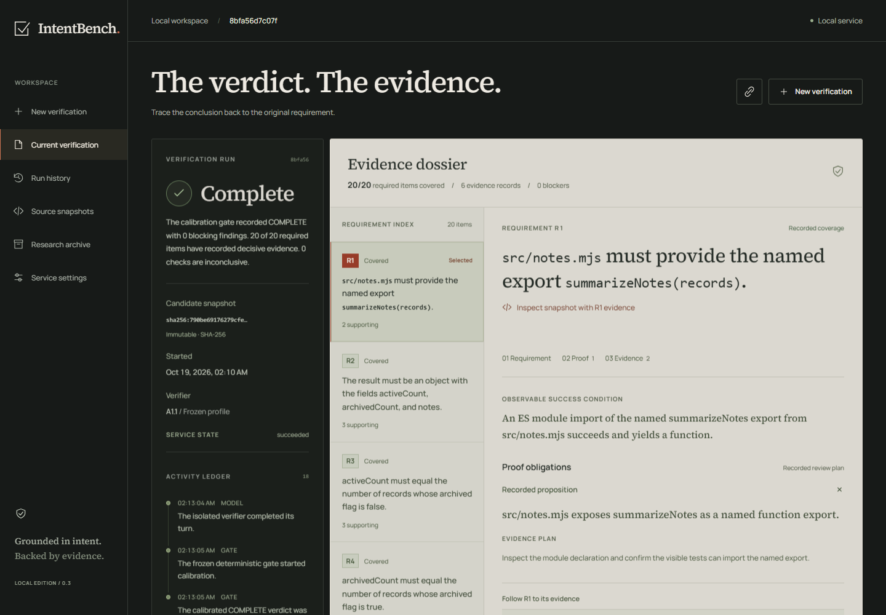
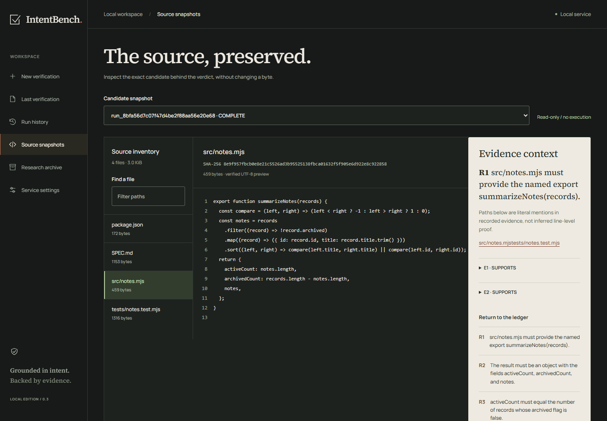

<div align="center">

# IntentBench

### Trace the verdict. Inspect the evidence.

A local verification workbench · public-source candidate · license pending approval

[Setup](docs/release/SETUP.md) · [Demo](docs/release/DEMO.md) · [Research](docs/release/RESEARCH.md) · [Security](docs/release/SECURITY.md)

</div>



_Recorded genuine acceptance evidence—not a live session or a database preloaded
into this export. COMPLETE is a verifier judgment, not guaranteed correctness._

**Release status:** unpublished; license/rights approval remains pending. The
October 29 npm dependency findings have been remediated with supported patch
updates. See the [dependency report](docs/release/DEPENDENCIES.md) and
[release audit](docs/release/AUDIT.md). This is not publication clearance.

## Inspect the claim behind the conclusion

Specification + candidate ZIP → atomic requirements → proof obligations → evidence
→ deterministic calibration → inspectable report.

The product has bounded archive intake, immutable snapshots, durable run state,
sanitized events, requirement/evidence navigation, source inspection, history and
JSON/Markdown exports. One frozen reasoning agent; no swarm or automatic repair.

## Two explicit modes

| Recorded browsing — default                                                  | Live verification — opt-in                                                  |
| ---------------------------------------------------------------------------- | --------------------------------------------------------------------------- |
| No Docker, credentials or model calls                                        | Requires the exact validated Docker image and dedicated authentication      |
| Six authentic published study tables and six selected sanitized trajectories | Real ZIP intake and isolated frozen A1.1 review                             |
| Clearly labeled REPLAY, no fabricated runs                                   | Loopback-only, bounded access, no shell internet or host execution fallback |
| Upload API is disabled before intake                                         | Unavailable prerequisites fail closed                                       |

## Run from a fresh checkout

Node **22.20.0**, npm **10.9.3**. No authentication needed for the default mode.

```sh
npm ci --ignore-scripts --no-audit --no-fund
npm run product:serve
```

Open <http://127.0.0.1:4317>. The default page is authentic research REPLAY. New
verification explains why live execution is disabled; no old product runs are seeded.
If another local IntentBench service already uses that port, see
[portable setup](docs/release/SETUP.md) for a different port.

**Live mode is not turnkey on a new machine.** The reference recipe is included,
but an arbitrary rebuild is not accepted as the pinned image. Do not alter its
identity or weaken the sandbox. [Live prerequisites and limits](docs/release/SETUP.md).

## Equal final accuracy. Different errors.

Frozen V0 and A1.1 reviewed the same twelve blinded holdout candidates using
`gpt-5.6-sol`, high reasoning. Both verdict sets froze before deterministic scoring.

| Final holdout           |               V0 |             A1.1 |
| ----------------------- | ---------------: | ---------------: |
| Classification accuracy | **8/12 (66.7%)** | **8/12 (66.7%)** |
| Mutants detected        |              6/6 |              5/6 |
| Goldens accepted        |              2/6 |              3/6 |
| False accepts           |              0/6 |              0/6 |
| False rejects           |              4/6 |              3/6 |
| UNKNOWN                 |             0/12 |             1/12 |
| Total runtime           |          12m 04s |          62m 28s |

**A1.1 did not improve final accuracy**, and used 5.175× the runtime. One additional
golden acceptance was offset by an invalid structured review. Small constructed
tasks do not establish statistical significance; possible oracle undercoverage is
also disclosed. [All twelve outcomes and limitations](docs/release/RESEARCH.md).

## Authentic evidence, not a simulated demo



The [evidence index](docs/release/EVIDENCE.md) includes four actual screenshots,
genuine acceptance JSON/Markdown and six complete sanitized trajectories, including
the advanced system's failure. The original saved database is intentionally absent.

## Read, reproduce, review

- [Local setup](docs/release/SETUP.md) and [no-credit reproduction](docs/release/REPRODUCTION.md)
- [Architecture](docs/release/ARCHITECTURE.md), [security](docs/release/SECURITY.md), [demo](docs/release/DEMO.md)
- [Release notes](RELEASE-NOTES.md), [audit](docs/release/AUDIT.md), [public file manifest](public-file-manifest.json)
- [License decision awaiting approval](LICENSE-DECISION.md), [third-party notices](third-party/NOTICES.md)

This independently initialized export contains no original Git objects, sealed
oracles/truth/variants, authentication or private local database. Retrospective
classifications in reviewed published results are historical evidence, not sealed
truth source files. No repository publication or deployment is authorized yet.
